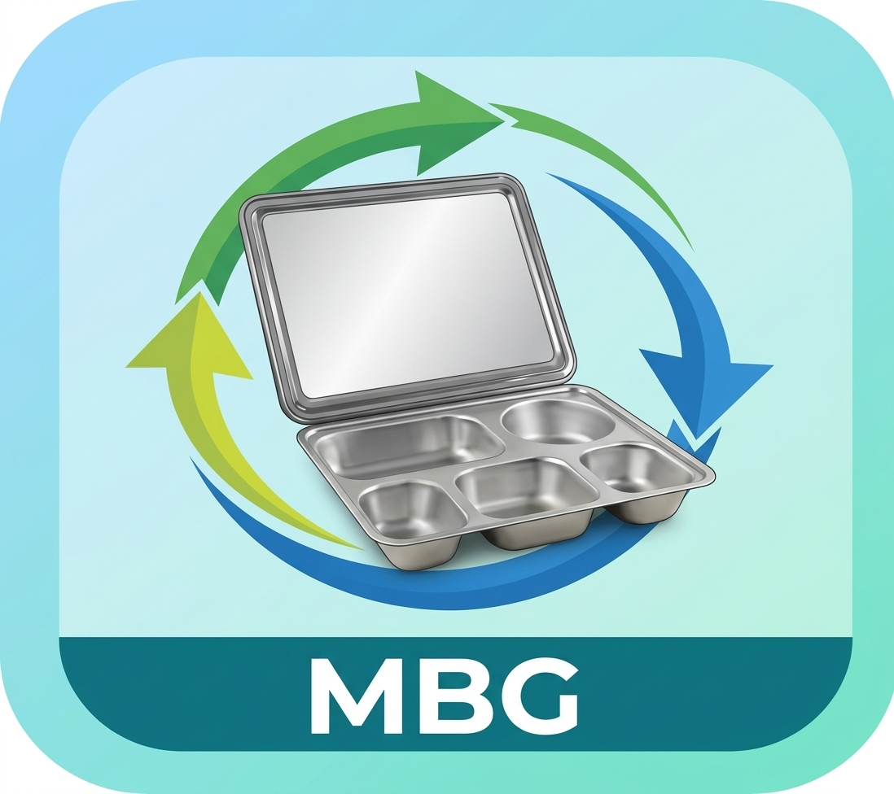

# MBG - Pencatatan Ompreng

Aplikasi desktop offline untuk mencatat pengambilan dan pengembalian ompreng Makanan Bergizi Gratis (MBG) memakai kartu RFID. Siswa tap kartu, operator mengisi jumlah, nama pengambil dan pengembali tercatat otomatis, dan laporan diekspor ke Excel dan PDF.

Dibuat dengan Go, SQLite, dan Wails v2. Berjalan di Windows 10+ dan Linux (Debian/Ubuntu, Red Hat/Fedora).



## Fitur

- Tap kartu: pengambilan pada tap pertama, pengembalian pada tap berikutnya
- Nama siswa pemilik kartu tampil di popup dan tercatat sebagai pengambil/pengembali
- Reader serial (ESP32-C3 + RC522) dan reader HID (keyboard emulator), terdeteksi otomatis
- Perlindungan tap ganda: penguncian popup, cooldown, jeda minimum ambil ke kembali
- Validasi: jumlah kembali tidak boleh melebihi jumlah ambil
- Tutup hari dengan catatan, dan buka kembali bila perlu
- Edit dan hapus transaksi dengan alasan wajib, tercatat di audit log
- Ekspor laporan formal ke Excel dan PDF (A4 landscape, kop dan logo instansi, kolom Pengambil dan Pengembali, baris merah untuk kekurangan)
- Data lokal di SQLite, tanpa login dan tanpa internet
- Pembaruan aplikasi dari GitHub Release (periksa otomatis, verifikasi checksum, cadangan database otomatis sebelum memperbarui)

## Instalasi

Unduh dari [halaman Releases](https://github.com/zulfikriyahya/sirkulasi-ompreng/releases/latest).

| OS | Berkas | Cara pasang |
|---|---|---|
| Windows 10/11 | `mbg-amd64-installer.exe` | Jalankan installer |
| Debian/Ubuntu | `mbg_0.2.0_amd64.deb` | `sudo apt install ./mbg_0.2.0_amd64.deb` |
| Fedora/RHEL 10 | `mbg-0.2.0-1.x86_64.rpm` | `sudo dnf install ./mbg-0.2.0-1.x86_64.rpm` |
| Linux (portabel) | `mbg-linux-amd64` | `chmod +x mbg-linux-amd64 && ./mbg-linux-amd64` |

Paket Linux memasang dependensi (GTK3 dan WebKitGTK 4.1) otomatis dan menyertakan aturan udev agar reader bisa diakses tanpa grup `dialout`. Cabut dan colok ulang reader setelah instalasi.

Windows memakai WebView2 (sudah ada di Windows 10/11 terbaru; installer menyertakannya bila belum ada).

## Penggunaan

1. **Master Data > Instansi**: isi nama, alamat, penanggung jawab, NIP, jabatan, dan unggah logo.
2. **Master Data > Kelas & Ketua**: tambahkan semua kelas.
3. **Master Data > Kartu RFID**: pilih kelas, tap kartu (atau ketik UID), isi NISN dan nama siswa (opsional), lalu Daftarkan.
4. **Beranda**: siswa tap kartu, operator mengisi jumlah, Submit. Tap lagi saat mengembalikan. Pengambil dan pengembali boleh berbeda orang.
5. Setelah semua kelas selesai (atau hari ditutup), klik **Cetak PDF**. Rentang tanggal tersedia di tab **Ekspor**.

Kartu tanpa NISN dan nama (kartu kelas) tetap berfungsi; kolom pengambil/pengembali menampilkan "-".

## Data

| OS | Lokasi |
|---|---|
| Linux | `~/.local/share/mbg/mbg.db` |
| Windows | `%APPDATA%\MBG\mbg.db` |

Data tidak terhapus saat update atau uninstall. Kolom baru ditambahkan otomatis saat aplikasi dibuka, jadi database versi lama tetap kompatibel.

Untuk mengosongkan, tutup aplikasi lalu hapus `mbg.db`, `mbg.db-wal`, dan `mbg.db-shm`.

Data: cadangan otomatis tersimpan di cadangan/ dalam folder data (~/.local/share/mbg/cadangan/ atau %APPDATA%\MBG\cadangan\), lima terakhir.

### Cadangan dan pemindahan database

Database memakai mode WAL, jadi jangan menyalin dengan `cp` saat aplikasi terbuka. Tutup aplikasi, lalu:

```bash
sqlite3 ~/.local/share/mbg/mbg.db ".backup /lokasi/cadangan/mbg.db"
```

Saat menimpa database di komputer lain, hapus dulu `mbg.db-wal` dan `mbg.db-shm` di folder tujuan.

### Privasi

`mbg.db` berisi NISN dan nama siswa. Jangan memasukkannya ke repositori atau rilis publik. File `.db`, `.csv`, dan `.tsv` data siswa sebaiknya masuk `.gitignore`.

## Firmware reader

Sketch ada di `firmware/esp32c3_rc522/`. Wiring ESP32-C3 Super Mini ke RC522:

| RC522 | ESP32-C3 |
|---|---|
| SDA (SS) | GPIO 7 |
| SCK | GPIO 4 |
| MOSI | GPIO 6 |
| MISO | GPIO 5 |
| RST | GPIO 3 |
| 3.3V | 3V3 (jangan 5V) |
| GND | GND |

Upload lewat Arduino IDE: board **ESP32C3 Dev Module**, **USB CDC On Boot: Enabled**, library **MFRC522**. Setiap tap mengirim 10 digit desimal (4 byte pertama UID, little-endian) dengan baud 115200.

## Pengembangan

Prasyarat: Go, Node.js/npm, Wails CLI, dan di Linux `libgtk-3-dev` serta `libwebkit2gtk-4.1-dev`.

```bash
go install github.com/wailsapp/wails/v2/cmd/wails@latest
go vet ./... && go test ./...
wails dev
```

## Build

Linux dibangun di Linux (CGO). Windows bisa dibangun dari Linux (tanpa CGO).

Prasyarat build (Debian/Ubuntu):

```bash
sudo apt install libgtk-3-dev libwebkit2gtk-4.1-dev nsis imagemagick
go install github.com/wailsapp/wails/v2/cmd/wails@latest
go install github.com/goreleaser/nfpm/v2/cmd/nfpm@latest
```

Ikon (sekali saja, dari `icon.jpeg`):

```bash
mkdir -p build/linux
convert icon.jpeg -gravity center -background white -resize 1024x1024 -extent 1024x1024 build/appicon.png
convert build/appicon.png -resize 512x512 build/linux/mbg.png
```

Build semua target:

```bash
go vet ./... && go test ./... || exit 1
rm -rf dist && mkdir -p dist
export VERSION=0.2.0
LDF="-X mbg/internal/versi.Versi=${VERSION}"

wails build -clean -ldflags "$LDF"
cp build/bin/mbg dist/mbg-linux-amd64

wails build -clean -platform windows/amd64 -nsis -webview2 embed -ldflags "$LDF"
cp build/bin/mbg-amd64-installer.exe dist/

nfpm package -p deb -t dist/
nfpm package -p rpm -t dist/

(cd dist && sha256sum mbg-linux-amd64 mbg_*.deb mbg-*.rpm mbg-amd64-installer.exe > checksums.txt)
```

Hasil di `dist/`: `mbg-linux-amd64`, `.deb`, `.rpm`, `mbg-amd64-installer.exe`, dan `checksums.txt` (dipakai fitur pembaruan untuk verifikasi SHA256).

Catatan: `nfpm.yaml` mengambil binary Linux dari `dist/mbg-linux-amd64`, jadi build Linux harus dijalankan lebih dulu. `.rpm` dari Debian 13 menautkan glibc baru, sehingga tidak cocok untuk RHEL/Rocky 9; bangun di container Rocky 9 untuk target itu.

## Rilis

Prasyarat: [GitHub CLI](https://cli.github.com) (`sudo apt install gh`, lalu `gh auth login`).

1. Tentukan nomor versi (contoh `0.2.0`). Versi aplikasi dan paket Linux diambil dari variabel `VERSION` saat build, jadi tidak ada lagi string versi yang diubah di kode:

   ```bash
   export VERSION=0.2.0
   sed -i "s/0\.4\.0/${VERSION}/g" README.md
   ```

2. Jalankan perintah di bagian **Build** (semua target) dengan `VERSION` yang sama.

3. Commit, beri tag, dan push:

   ```bash
   git add -A
   git commit -m "Rilis v${VERSION}"
   git tag -a "v${VERSION}" -m "Versi ${VERSION}"
   git push origin main --tags
   ```

4. Buat release di GitHub dan unggah semua berkas:

   ```bash
   gh release create "v${VERSION}" dist/* \
     --title "v${VERSION}" \
     --notes "Catatan perubahan versi ${VERSION}."
   ```

   Untuk catatan otomatis dari riwayat commit, ganti `--notes "..."` dengan `--generate-notes`.

### Merebuild versi yang sama

Jika perlu membangun ulang tanpa menaikkan versi:

```bash
git add -A && git commit -m "Perbaikan v${VERSION}"
git push origin main
git tag -fa "v${VERSION}" -m "Versi ${VERSION}"
git push origin "v${VERSION}" --force
gh release upload "v${VERSION}" dist/* --clobber
```

Verifikasi:

```bash
gh release view "v${VERSION}" --json assets --jq '.assets[] | "\(.name) \(.size)"'
git ls-remote --tags origin "v${VERSION}*"
```

Hasil `v${VERSION}^{}` harus menunjuk ke commit `HEAD`, dan ukuran aset sama dengan file di `dist/`.

## Struktur

```
main.go            entry Wails
internal/          db, model, service, reader, export, timeutil
frontend/          HTML/CSS/JS vanilla
firmware/          sketch ESP32-C3 + RC522
build/             ikon, aturan udev, berkas paket
dist/              hasil build (tidak masuk git)
```

## Lisensi

[MIT](LICENSE)

---

built with ♥ by [Yahya Zulfikri](https://zulfikriyahya.my.id)
