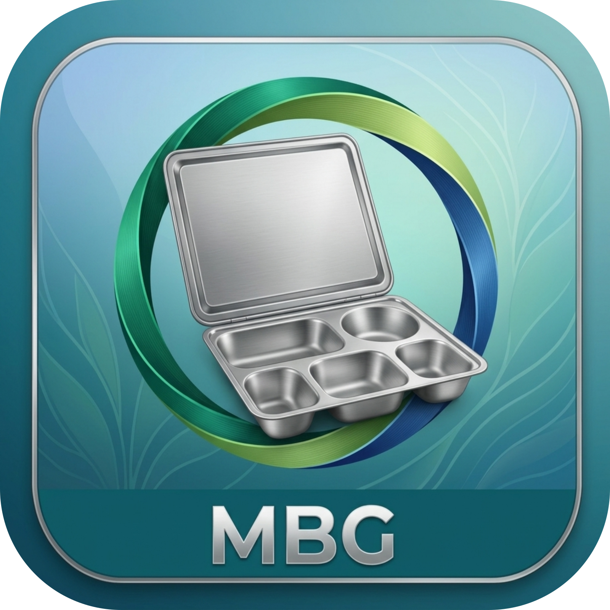

# SI'OM - Sirkulasi Ompreng MBG

Aplikasi desktop offline-first untuk mencatat pengambilan dan pengembalian ompreng Makanan Bergizi Gratis (MBG) memakai kartu RFID. Siswa tap kartu, operator mengisi jumlah, nama pengambil dan pengembali tercatat otomatis, wali kelas dapat menerima notifikasi WhatsApp, dan laporan diekspor ke Excel dan PDF.

Dibuat dengan Go, SQLite, dan Wails v2. Berjalan di Windows 10+ dan Linux (Debian/Ubuntu, Red Hat/Fedora).



## Fitur

**Pencatatan**
- Tap kartu: pengambilan pada tap pertama, pengembalian pada tap berikutnya
- Pengembalian susulan: status KURANG sampai jumlah kembali lengkap
- Nama siswa pemilik kartu tampil di popup dan tercatat sebagai pengambil/pengembali
- Reader serial (ESP32-C3 + RC522) dan reader HID (keyboard emulator), terdeteksi otomatis
- Perlindungan tap ganda: penguncian popup, cooldown, jeda minimum ambil ke kembali
- Validasi: jumlah kembali tidak boleh melebihi jumlah ambil
- Tutup hari dengan catatan, dan buka kembali bila perlu
- Edit dan hapus transaksi dengan alasan wajib, tercatat di audit log

**Notifikasi WhatsApp ke wali kelas**
- Pesan otomatis ke wali kelas saat kelasnya mengambil dan mengembalikan ompreng
- Memakai antrean di database: operator tidak menunggu jaringan dan pesan tidak hilang saat internet putus
- Uji kirim, riwayat notifikasi, dan tombol Ulangi untuk pesan gagal
- Detail di bagian [Notifikasi WhatsApp](#notifikasi-whatsapp)

**Master data dan laporan**
- Master data: instansi, kelas, wali kelas, kartu RFID
- Sinkronisasi master data antar komputer: ekspor/impor Excel dan CSV dengan pratinjau sebelum diterapkan
- Ekspor laporan formal ke Excel dan PDF (A4 landscape, kop dan logo instansi, kolom Pengambil dan Pengembali, baris merah untuk kekurangan)
- Audit log untuk setiap perubahan data

**Sistem**
- Data lokal di SQLite, tanpa login. Internet hanya dibutuhkan untuk WhatsApp dan pembaruan
- Pembaruan aplikasi dari GitHub Release (periksa otomatis, verifikasi checksum, cadangan database otomatis sebelum memperbarui)

## Instalasi

Unduh dari [halaman Releases](https://github.com/zulfikriyahya/sirkulasi-ompreng/releases/latest).

| OS | Berkas | Cara pasang |
|---|---|---|
| Windows 10/11 | `mbg-amd64-installer.exe` | Jalankan installer |
| Debian/Ubuntu | `mbg_0.3.0_amd64.deb` | `sudo apt install ./mbg_0.3.0_amd64.deb` |
| Fedora/RHEL 10 | `mbg-0.3.0-1.x86_64.rpm` | `sudo dnf install ./mbg-0.3.0-1.x86_64.rpm` |
| Linux (portabel) | `mbg-linux-amd64` | `chmod +x mbg-linux-amd64 && ./mbg-linux-amd64` |

Paket Linux memasang dependensi (GTK3 dan WebKitGTK 4.1) otomatis dan menyertakan aturan udev agar reader Espressif bisa diakses tanpa grup `dialout`. Cabut dan colok ulang reader setelah instalasi.

Windows memakai WebView2 (sudah ada di Windows 10/11 terbaru; installer menyertakannya bila belum ada).

## Penggunaan

1. **Master Data > Pengaturan**: isi nama, alamat, penanggung jawab, NIP, jabatan, dan unggah logo.
2. **Master Data > Kelas**: tambahkan semua kelas beserta ketua murid.
3. **Master Data > Wali Kelas**: tambahkan wali kelas dan nomor WhatsApp-nya, lalu pilih wali untuk tiap kelas di tab **Kelas**.
4. **Master Data > Kartu RFID**: pilih kelas, tap kartu (atau ketik UID), isi NISN dan nama siswa (opsional), lalu Daftarkan.
5. **Master Data > WhatsApp** (opsional): atur notifikasi, lihat [Notifikasi WhatsApp](#notifikasi-whatsapp).
6. **Beranda**: siswa tap kartu, operator mengisi jumlah, Submit. Tap lagi saat mengembalikan. Pengambil dan pengembali boleh berbeda orang.
7. Setelah semua kelas selesai (atau hari ditutup), klik **Cetak PDF**. Rentang tanggal tersedia di tab **Ekspor**.

Kartu tanpa NISN dan nama (kartu kelas) tetap berfungsi; kolom pengambil/pengembali menampilkan "-".

## Notifikasi WhatsApp

Aplikasi mengirim pesan lewat layanan WhatsApp milik instansi (`POST /api/v1/messages`) dengan autentikasi HMAC-SHA256. Fitur ini nonaktif secara bawaan.

### Cara kerja

1. Setelah **Submit ambil** atau **Submit kembali** berhasil tersimpan, pesan dimasukkan ke tabel antrean (`wa_antrean`).
2. Worker di latar belakang mengirim antrean setiap 20 detik, atau segera setelah ada pesan baru.
3. Pencatatan ompreng tidak pernah gagal karena WhatsApp: galat antrean hanya dicatat ke log.

Aturan pengiriman:

| Kondisi | Perilaku |
|---|---|
| Kelas belum punya wali aktif | Tidak ada pesan |
| Fitur WhatsApp nonaktif | Tidak ada pesan |
| Jaringan putus atau server 5xx | Dicoba ulang dengan jeda 2, 4, 8, ... menit (maksimal 1 jam), hingga 8 kali, lalu GAGAL |
| API key salah (401) atau dijeda (429) | Seluruh batch ditahan, dicoba lagi 10 menit kemudian |
| Ditolak layanan (mis. variabel template kurang) | Langsung GAGAL |
| Lebih dari 24 jam di antrean | GAGAL (kedaluwarsa), agar wali tidak kebanjiran pesan lama |

Setiap pesan memakai `reference_id` unik (`mbg-ambil-<id transaksi>`, `mbg-kembali-<id pengembalian>`), sehingga tidak ada pesan ganda. Pesan GAGAL bisa dikirim ulang dengan tombol **Ulangi** di riwayat notifikasi. Koreksi lewat menu Riwayat (edit/hapus transaksi) tidak mengirim pesan.

### Persiapan di dashboard layanan

1. Siapkan API key (Key ID dan Secret).
2. Buat dua template (Menu **Template**, prioritas Medium, minimal 2 varian per template) dan kaitkan ke API key tersebut.

| Kode bawaan | Variabel wajib |
|---|---|
| `ompreng_ambil` | `nama_wali,kelas,ketua,pengambil,jumlah_ambil,tanggal,jam,instansi` |
| `ompreng_kembali` | `nama_wali,kelas,ketua,jenis,pengembali,jumlah_ambil,jumlah_kembali,total_kembali,sisa,status,tanggal,jam,instansi` |

Varian `ompreng_ambil` (minimal 2):

```
Assalamualaikum {{nama_wali}}, kelas {{kelas}} telah mengambil {{jumlah_ambil}} ompreng pada {{tanggal}} pukul {{jam}}. Diambil oleh {{pengambil}}. Terima kasih.
```
```
Yth. {{nama_wali}}, ompreng kelas {{kelas}} sejumlah {{jumlah_ambil}} sudah diambil {{pengambil}} pada {{tanggal}} pukul {{jam}}. Salam dari {{instansi}}.
```

Varian `ompreng_kembali` (minimal 2):

```
{{jenis}} kelas {{kelas}} pada {{tanggal}} pukul {{jam}}: {{jumlah_kembali}} ompreng dikembalikan oleh {{pengembali}}. Total kembali {{total_kembali}} dari {{jumlah_ambil}} ompreng. Status: {{status}}.
```
```
Halo {{nama_wali}}, ada {{jenis}} untuk kelas {{kelas}} ({{tanggal}}, {{jam}}). Total sudah kembali {{total_kembali}} dari {{jumlah_ambil}}, sisa {{sisa}}. Status: {{status}}.
```

Arti variabel:
- `jumlah_kembali`: jumlah pada pengembalian kali ini. `total_kembali`: akumulasi hari itu. `sisa`: jumlah yang belum kembali.
- `status`: `Lengkap` atau `Kurang N Ompreng`.
- `jenis`: `Pengembalian` atau `Pengembalian susulan`.
- Variabel yang kosong dikirim sebagai `-`.

Validator layanan menolak huruf kapital berlebihan, `!!` berurutan, dan lebih dari satu tautan per varian. Kode template bisa diubah di aplikasi.

### Pengaturan di aplikasi

Buka **Master Data > WhatsApp**, isi alamat layanan, Key ID, Secret, dan kode kedua template, centang **Aktifkan**, lalu **Simpan**. Kirim **pesan uji** ke nomor Anda untuk memastikan kredensial dan template benar (uji memakai template pengambilan; template pengembalian baru teruji pada pengembalian sungguhan).

Secret tidak pernah ditampilkan kembali di antarmuka; kosongkan kolomnya untuk mempertahankan secret lama.

### Keterbatasan saat ini

Kolom Keterangan menampilkan status saat pesan diterima layanan (mis. `queued`). Status lanjutan (`sent`, `delivered`, `read`) belum ditarik otomatis dari `GET /api/v1/messages/{job_id}`.

## Data

| OS | Lokasi |
|---|---|
| Linux | `~/.local/share/mbg/mbg.db` |
| Windows | `%APPDATA%\MBG\mbg.db` |

Data tidak terhapus saat update atau uninstall. Kolom dan tabel baru ditambahkan otomatis saat aplikasi dibuka, jadi database versi lama tetap kompatibel.

Untuk mengosongkan, tutup aplikasi lalu hapus `mbg.db`, `mbg.db-wal`, dan `mbg.db-shm`.

Cadangan otomatis (dibuat sebelum pembaruan) tersimpan di folder `cadangan/` dalam folder data (`~/.local/share/mbg/cadangan/` atau `%APPDATA%\MBG\cadangan\`), lima terakhir.

### Cadangan dan pemindahan database

Database memakai mode WAL, jadi jangan menyalin dengan `cp` saat aplikasi terbuka. Tutup aplikasi, lalu:

```bash
sqlite3 ~/.local/share/mbg/mbg.db ".backup /lokasi/cadangan/mbg.db"
```

Saat menimpa database di komputer lain, hapus dulu `mbg.db-wal` dan `mbg.db-shm` di folder tujuan.

### Sinkronisasi master data

Di **Master Data > Pengaturan** tersedia ekspor (Excel, atau CSV per jenis: kelas, kartu, wali), template impor kosong, dan impor.

- Excel memuat sheet Pengaturan, Kelas, Kartu, dan Wali. CSV dikenali dari header kolomnya.
- Impor selalu menampilkan pratinjau dan tidak menulis apa pun sebelum **Terapkan**. Seluruh impor berjalan dalam satu transaksi.
- Mode **Gabung** hanya menambah dan memperbarui. Mode **Ganti** juga menghapus kartu serta menonaktifkan kelas dan wali yang tidak ada di berkas (butuh konfirmasi dan alasan).
- Logo, port serial, ambang HID, dan konfigurasi WhatsApp tidak ikut disinkronkan.
- Ekspor menolak disimpan di dalam folder repositori git.

### Privasi

- `mbg.db` berisi NISN, nama siswa, nomor WhatsApp wali, dan **Secret API WhatsApp (tersimpan sebagai teks biasa)**. Berkas cadangan juga memuatnya. Jangan memasukkan database atau cadangan ke repositori, rilis publik, atau folder yang dibagikan.
- Berkas ekspor kartu berisi NISN dan nama siswa; hapus setelah dipakai.
- Sebaiknya `.gitignore` memuat `*.db`, `*.csv`, `*.tsv`, dan `*.xlsx` data siswa.
- Secret tidak masuk audit log dan tidak ikut ekspor sinkronisasi.

## Pembaruan aplikasi

Di **Master Data > Pengaturan** tersedia tombol **Periksa pembaruan**, opsi periksa otomatis, dan opsi pra-rilis. Saat memasang pembaruan, aplikasi:

1. mencadangkan database,
2. mengunduh berkas rilis dan memverifikasi ukuran serta checksum SHA256 (`checksums.txt`),
3. Windows: menjalankan installer dan menutup aplikasi. Linux: menampilkan perintah `sudo apt/dnf install ...` untuk dijalankan sendiri (sudo tidak dijalankan otomatis).

## Firmware reader

Sketch ada di `firmware/esp32c3_rc522/`. Wiring ESP32-C3 Super Mini ke RC522:

| RC522 | ESP32-C3 |
|---|---|
| SDA (SS) | GPIO 7 |
| SCK | GPIO 4 |
| MOSI | GPIO 6 |
| MISO | GPIO 5 |
| RST | GPIO 3 |
| 3.3V | 3V3 (jangan 5V) |
| GND | GND |

Upload lewat Arduino IDE: board **ESP32C3 Dev Module**, **USB CDC On Boot: Enabled**, library **MFRC522**. Setiap tap mengirim 10 digit desimal (4 byte pertama UID, little-endian) dengan baud 115200.

## Pengembangan

Prasyarat: Go, Node.js/npm, Wails CLI, dan di Linux `libgtk-3-dev` serta `libwebkit2gtk-4.1-dev`.

```bash
go install github.com/wailsapp/wails/v2/cmd/wails@latest
gofmt -l internal && go build ./... && go vet ./... && go test ./...
wails dev
```

Binding Go ke frontend dibuat otomatis oleh `wails dev` (`frontend/wailsjs`). Frontend memakai HTML/CSS/JS vanilla tanpa langkah build.

## Build

Linux dibangun di Linux (CGO). Windows bisa dibangun dari Linux (tanpa CGO).

Prasyarat build (Debian/Ubuntu):

```bash
sudo apt install libgtk-3-dev libwebkit2gtk-4.1-dev nsis imagemagick
go install github.com/wailsapp/wails/v2/cmd/wails@latest
go install github.com/goreleaser/nfpm/v2/cmd/nfpm@latest
```

Ikon (sekali saja, dari `icon.png`):

```bash
mkdir -p build/linux
convert icon.png -background none -gravity center -resize 1024x1024 -extent 1024x1024 build/appicon.png
convert build/appicon.png -resize 512x512 build/linux/mbg.png
```

Build semua target:

```bash
go vet ./... && go test ./... || exit 1
rm -rf dist && mkdir -p dist
export VERSION=0.3.0
LDF="-X mbg/internal/versi.Versi=${VERSION}"

wails build -clean -ldflags "$LDF"
cp build/bin/mbg dist/mbg-linux-amd64

wails build -clean -platform windows/amd64 -nsis -webview2 embed -ldflags "$LDF"
cp build/bin/mbg-amd64-installer.exe dist/

nfpm package -p deb -t dist/
nfpm package -p rpm -t dist/

(cd dist && sha256sum mbg-linux-amd64 mbg_*.deb mbg-*.rpm mbg-amd64-installer.exe > checksums.txt)
```

Hasil di `dist/`: `mbg-linux-amd64`, `.deb`, `.rpm`, `mbg-amd64-installer.exe`, dan `checksums.txt` (dipakai fitur pembaruan untuk verifikasi SHA256).

Catatan: `nfpm.yaml` mengambil binary Linux dari `dist/mbg-linux-amd64`, jadi build Linux harus dijalankan lebih dulu. `.rpm` dari Debian 13 menautkan glibc baru, sehingga tidak cocok untuk RHEL/Rocky 9; bangun di container Rocky 9 untuk target itu.

## Rilis

Prasyarat: [GitHub CLI](https://cli.github.com) (`sudo apt install gh`, lalu `gh auth login`).

1. Tentukan nomor versi dan perbarui nomor versi lama di README. Versi aplikasi dan paket Linux diambil dari variabel `VERSION` saat build, jadi tidak ada string versi yang diubah di kode:

   ```bash
   export VERSION=0.3.0
   sed -i "s/0\.2\.1/${VERSION}/g" README.md   # ganti 0.2.1 dengan versi sebelumnya
   ```

2. Jalankan perintah di bagian **Build** (semua target) dengan `VERSION` yang sama.

3. Commit, beri tag, dan push:

   ```bash
   git add -A
   git commit -m "Rilis v${VERSION}"
   git tag -a "v${VERSION}" -m "Versi ${VERSION}"
   git push origin main --tags
   ```

4. Buat release di GitHub dan unggah semua berkas:

   ```bash
   gh release create "v${VERSION}" dist/* \
     --title "v${VERSION}" \
     --notes "Catatan perubahan versi ${VERSION}."
   ```

   Untuk catatan otomatis dari riwayat commit, ganti `--notes "..."` dengan `--generate-notes`.

### Merebuild versi yang sama

Jika perlu membangun ulang tanpa menaikkan versi:

```bash
git add -A && git commit -m "Perbaikan v${VERSION}"
git push origin main
git tag -fa "v${VERSION}" -m "Versi ${VERSION}"
git push origin "v${VERSION}" --force
gh release upload "v${VERSION}" dist/* --clobber
```

Verifikasi:

```bash
gh release view "v${VERSION}" --json assets --jq '.assets[] | "\(.name) \(.size)"'
git ls-remote --tags origin "v${VERSION}*"
```

Hasil `v${VERSION}^{}` harus menunjuk ke commit `HEAD`, dan ukuran aset sama dengan file di `dist/`.

## Struktur

```
main.go                  entry Wails
internal/
  db/                    koneksi SQLite, skema, migrasi
  model/                 struktur data
  service/               logika aplikasi (transaksi, hari, master, wali,
                         sinkron, ekspor, pembaruan, antrean WhatsApp)
  reader/                reader serial dan normalisasi UID
  whatsapp/              klien API WhatsApp (HMAC-SHA256)
  sinkron/               baca/tulis berkas impor-ekspor xlsx/csv
  pembaruan/             klien GitHub Release, semver, checksum
  export/                laporan Excel dan PDF
  timeutil/              format tanggal dan waktu (WIB)
  versi/                 nomor versi (disuntik saat build)
frontend/                HTML/CSS/JS vanilla
firmware/                sketch ESP32-C3 + RC522
build/                   ikon, aturan udev, berkas paket
dist/                    hasil build (tidak masuk git)
```

## Lisensi

[MIT](LICENSE)

---

built with ♥ by [Yahya Zulfikri](https://zulfikriyahya.my.id)
